<div align="center">



### Find out what your resume actually says.

<p>
  <a href="https://debugmycv.vercel.app"></a>
  
  
  
  
</p>

[**What is it?**](#what-is-it) •
[**How it works**](#how-it-works) •
[**Features**](#features) •
[**Tech stack**](#tech-stack) •
[**Quick start**](#quick-start) •
[**Configuration**](#configuration) •
[**Layout**](#project-layout) •
[**Deploy**](#deploy) •
[**Contributing**](#contributing)

</div>

---

<div align="center">
<a id="what-is-it"></a>

</div>

**DebugMyCV** treats your resume like code. Upload your resume, paste in a job description, and get back a clear **match score**, the **skills you're missing**, and **suggestions to improve** it. Think of it as a linter for your CV: it points at the exact lines that will cost you the interview.

👉 **Try it live:** [debugmycv.vercel.app](https://debugmycv.vercel.app)

---

<div align="center">
<a id="how-it-works"></a>

</div>

1. **Upload** your resume.
2. **Add** the job description you're targeting.
3. **Get your report:** match score, missing skills and improvement suggestions.

> The numbers shown in the banner above (78%, Docker, CI/CD) are only a sample, not real output.

---

<div align="center">
<a id="features"></a>

</div>

- 🎯 **Match score**: how well your resume fits a specific job description
- 🐛 **Missing skills**: what the job asks for that your resume doesn't show
- 🛠️ **Improvement suggestions**: concrete ways to fix your resume
- 🤖 **AI analysis** powered by [Groq](https://groq.com) (`llama-3.3-70b-versatile` by default)
- ⏱️ **Daily limits per user** so the free tier stays healthy (defaults: 5 uploads and 10 analyses per day, resets on the Asia/Kolkata calendar day)
- 📄 **File size guard**: resumes up to 4 MB by default (Vercel request body limit is about 4.5 MB)
- 🔐 **Session-based auth** and secrets kept in environment variables

All limits are configurable. See [Configuration](#configuration).

---

<div align="center">
<a id="tech-stack"></a>

</div>

| Layer         | What                                              |
| ------------- | ------------------------------------------------- |
| **Client**    | Web app in [`client/`](client) (dev server on port `5173`) |
| **Server**    | Node.js API in [`server/`](server) (port `5000`)  |
| **Database**  | Supabase (Postgres), setup in [`database/`](database) |
| **AI**        | Groq API, `llama-3.3-70b-versatile`               |
| **Hosting**   | Vercel (see [`vercel.json`](vercel.json))         |

```text
 client  ───►  server  ───►  Groq AI  (resume vs job description)
                  │
                  └───────►  Supabase Postgres  (users, quotas, reports)
```

---

<div align="center">
<a id="quick-start"></a>

</div>

**You'll need:** Node.js 18+, a [Supabase](https://supabase.com) project (Postgres) and a [Groq API key](https://console.groq.com/keys).

```bash
# 1. get the code
git clone https://github.com/AkkhileshCod3s/DebugMyCV.git
cd DebugMyCV

# 2. set up your environment (the server reads server/.env)
cp .env.example server/.env        # Windows: copy .env.example server\.env
# now open server/.env and fill in DATABASE_URL, SESSION_SECRET and GROQ_API_KEY

# 3. set up the database using the files in database/

# 4. start the server
cd server
npm install
npm run dev

# 5. start the client (new terminal)
cd client
npm install
npm run dev                         # http://localhost:5173
```

> 💡 Script names can differ per folder. Check the `scripts` section of `server/package.json` and `client/package.json` if a command isn't found.

---

<div align="center">
<a id="configuration"></a>

</div>

Copy [`.env.example`](.env.example) to `server/.env` and fill it in. **Never commit your real `.env` file.**

| Variable                     | Required | Default / example                | What it does                                           |
| ---------------------------- | :------: | -------------------------------- | ------------------------------------------------------ |
| `PORT`                       |          | `5000`                           | Server port                                            |
| `NODE_ENV`                   |          | `production`                     | Runtime mode                                           |
| `FRONTEND_URL`               |          | your site URL                    | Allowed frontend origin                                |
| `CLIENT_PORT`                |          | `5173`                           | Client dev server port                                 |
| `DATABASE_URL`               |    ✅    | Supabase pooled connection string | Postgres connection                                    |
| `DB_POOL_SIZE`               |          | `3`                              | Database pool size                                     |
| `SESSION_SECRET`             |    ✅    | 32+ random characters            | Signs user sessions (required in production)           |
| `JWT_SECRET`                 |          |                                  | Optional, for token-based auth later                   |
| `GROQ_API_KEY`               |    ✅    |                                  | Needed for AI analysis                                 |
| `GROQ_MODEL`                 |          | `llama-3.3-70b-versatile`        | Model used for analysis                                |
| `MAX_RESUME_UPLOADS_PER_DAY` |          | `5`                              | Successful uploads per user per day                    |
| `MAX_ANALYSES_PER_DAY`       |          | `10`                             | Successful AI analyses per user per day                |
| `MAX_RESUME_FILE_SIZE_MB`    |          | `4`                              | Max resume size (Vercel body limit is about 4.5 MB)    |
| `MAX_INPUT_CHARACTERS`       |          | `20000`                          | Max characters of resume / job description text        |
| `MAX_OUTPUT_TOKENS`          |          | `2500`                           | Max tokens requested from the model per analysis       |
| `AI_ENABLED`                 |          | `true`                           | Switch AI analysis on or off                           |
| `APP_TIMEZONE`               |          | `Asia/Kolkata`                   | Timezone used for the daily quotas                     |

---

<div align="center">
<a id="project-layout"></a>

</div>

```text
DebugMyCV/
├── client/         the web app (UI)
├── server/         API + AI analysis
├── database/       database setup
├── .env.example    config template
├── .gitignore
└── vercel.json     Vercel config
```

---

<div align="center">
<a id="deploy"></a>

</div>

1. Push the repo to GitHub.
2. Import it in [Vercel](https://vercel.com/new). `vercel.json` is already included.
3. Add the environment variables from [Configuration](#configuration) in the Vercel dashboard.
4. Deploy. Keep `MAX_RESUME_FILE_SIZE_MB` at `4` or lower so uploads fit within Vercel's request body limit.

---

<div align="center">
<a id="contributing"></a>

</div>

Found a bug in the bug-finder? Have an idea? Contributions are welcome.

1. **Fork** the repo
2. Create a branch: `git checkout -b feature/my-idea`
3. Make your change and run it locally
4. Commit, push and open a **pull request**

---

<div align="center">

Made with ❤️ by [@AkkhileshCod3s](https://github.com/AkkhileshCod3s)

If DebugMyCV helped you land an interview, drop a ⭐ and tell **Resumey** he did a good job!

</div>